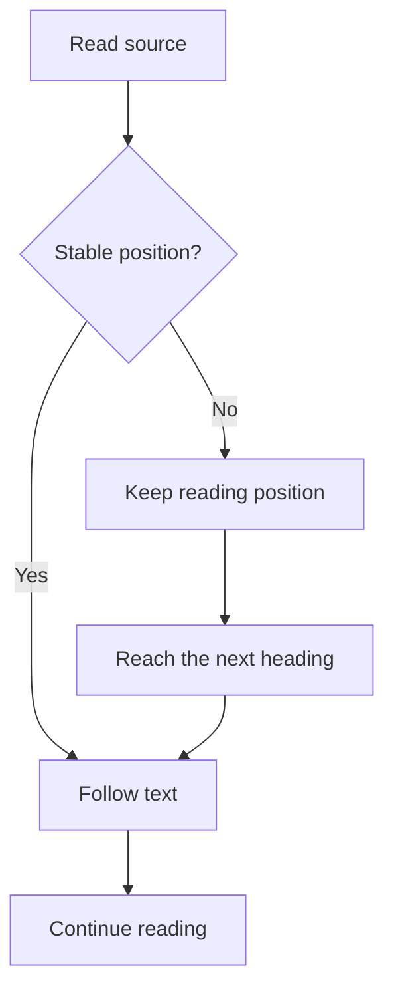
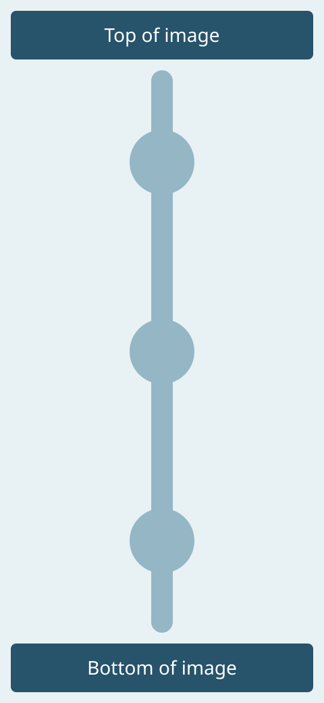

# Preview scroll fixture

Open this file in Markdown split view. Scroll the source pane from this
introduction through the two identically named checkpoints. Ordinary text
follows while the preview has a reliable source position. The preview can
hold its reading position while the source passes through a complex block.

## Checkpoint

This is the checkpoint before the complex layouts.

This plain paragraph has enough consecutive source lines to exercise
ordinary text following before the first table. Each line continues
the same paragraph with visible words that can be found in the preview.
Resizing the divider changes the wrapping of these words independently
on each side. The source position is still the shared reference.
This sentence marks the end of the plain paragraph.

| Sample | Quantity | Remarks |
| :--- | ---: | :--- |
| Alpha | 12 | A short remark |
| Beta | 48 | A longer remark that wraps in a narrow preview column |
| Gamma | 96 | Additional detail for multiline table layout |
| Delta | 120 | One cell contains **emphasis** and `inline code` |
| Epsilon | 144 | A wide value with more than a few words |
| Zeta | 168 | Another table row |
| Eta | 192 | Another table row |
| Theta | 216 | Another table row |
| Iota | 240 | Another table row |
| Kappa | 264 | Another table row |
| Lambda | 288 | Another table row |
| Mu | 312 | The final table row |





```markdown
# Example heading inside a literal block

This is source code in the rendered document.
The heading here is displayed as literal text.
It is part of the complex region.
```

$$
\sum_{k=1}^{n} k = \frac{n(n+1)}{2}
$$

## Checkpoint

This is the checkpoint after the table, diagram, image, code, and formula.
It has the same title as the earlier checkpoint so a test can distinguish
the two by source position.

## Final section

The last section leaves enough room to scroll down and reverse direction.

Try scrolling the preview on its own, then scroll the source again. The
preview follows the source at the next reliable position.

This is the end of the fixture.
