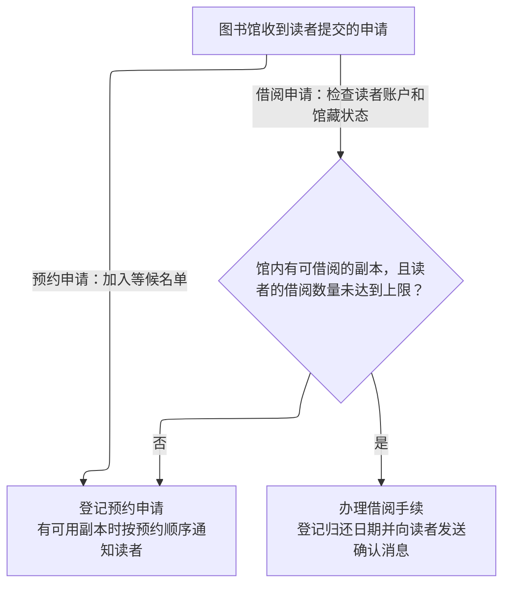
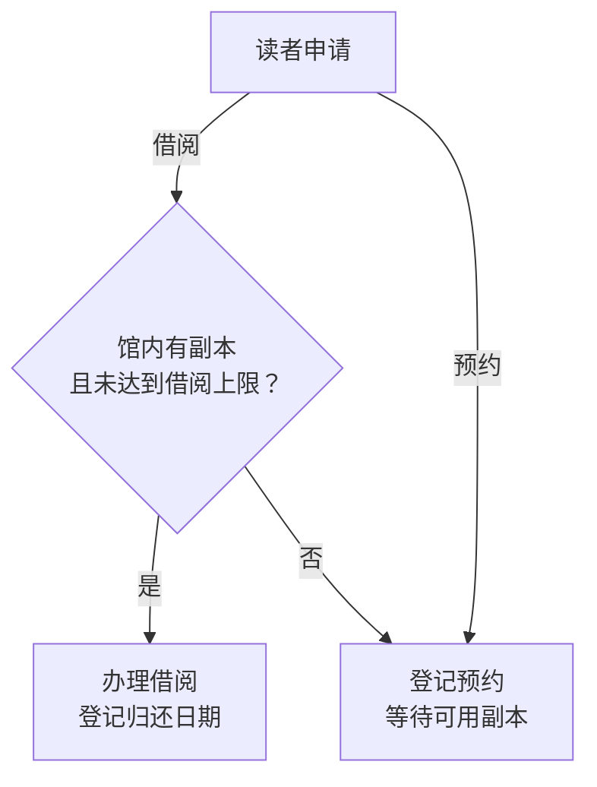
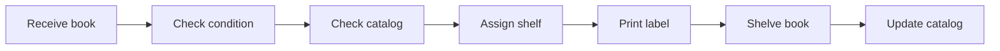
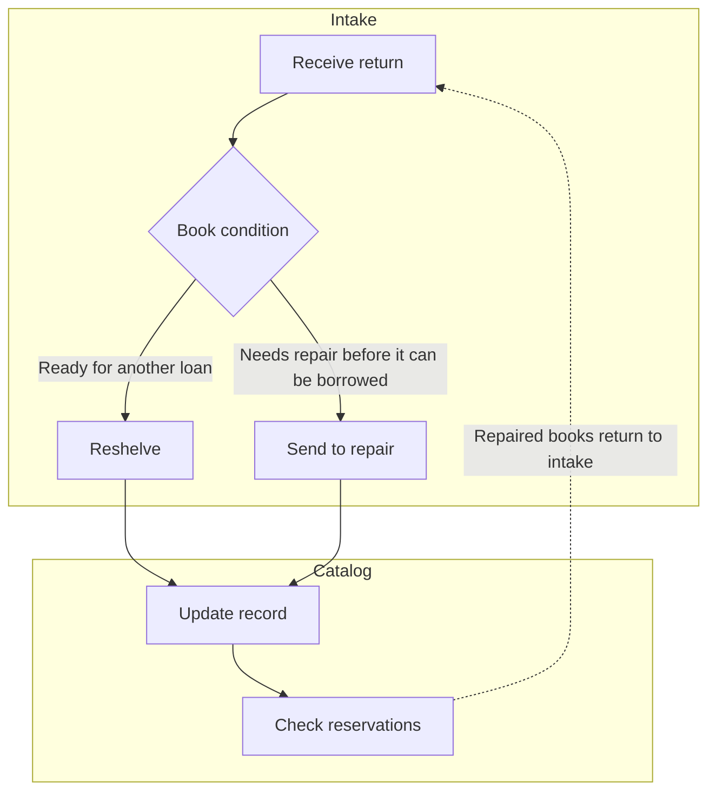
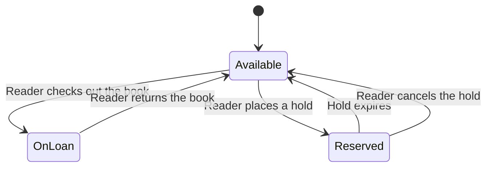
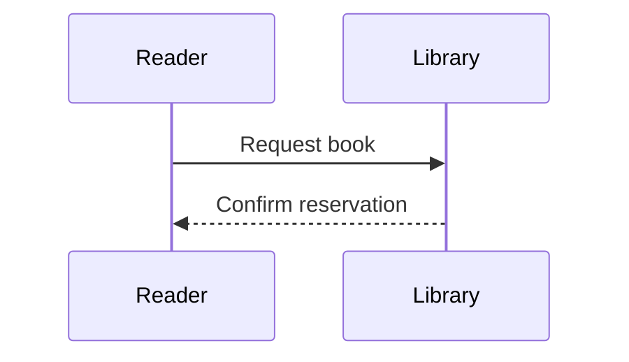
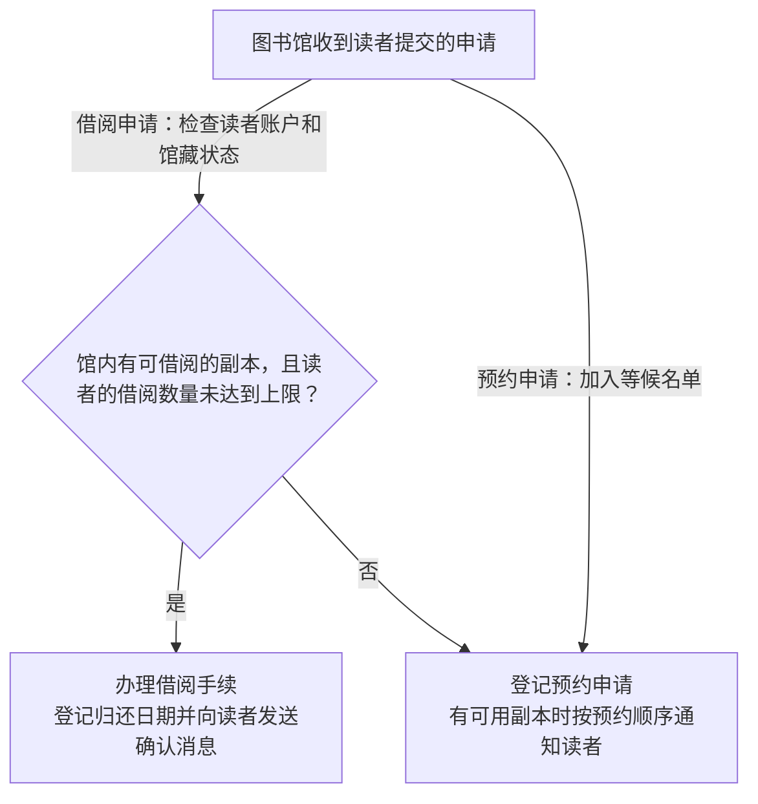

# Mermaid layout cases

## Long Chinese labels with explicit ELK layout

## Explicit line breaks and shorter labels

## Wide horizontal chain

## Nested groups, shared targets and feedback

## State diagram with parallel transitions

## Sequence diagram as a control

## Long Chinese labels with the default layout

This example repeats the first graph with the default layout.

